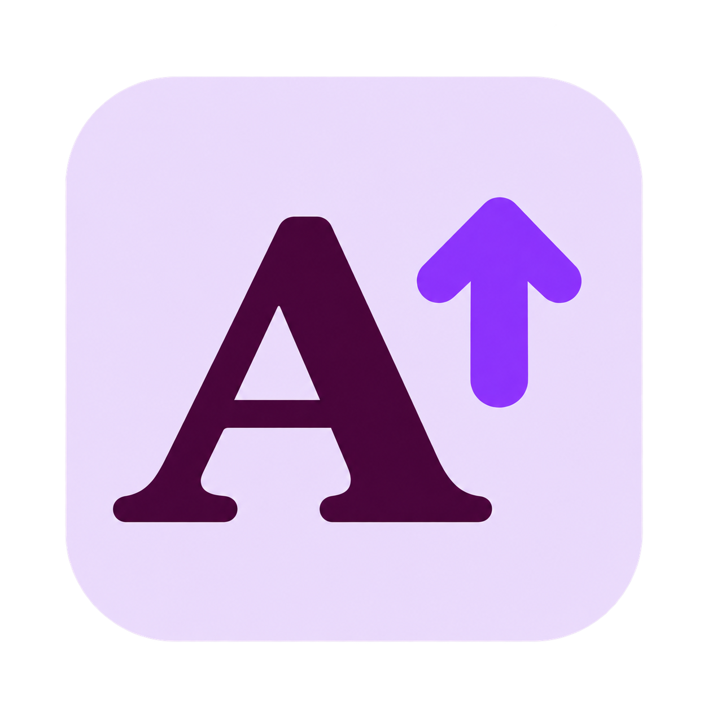
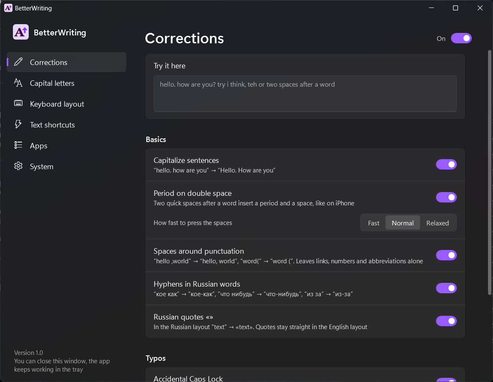
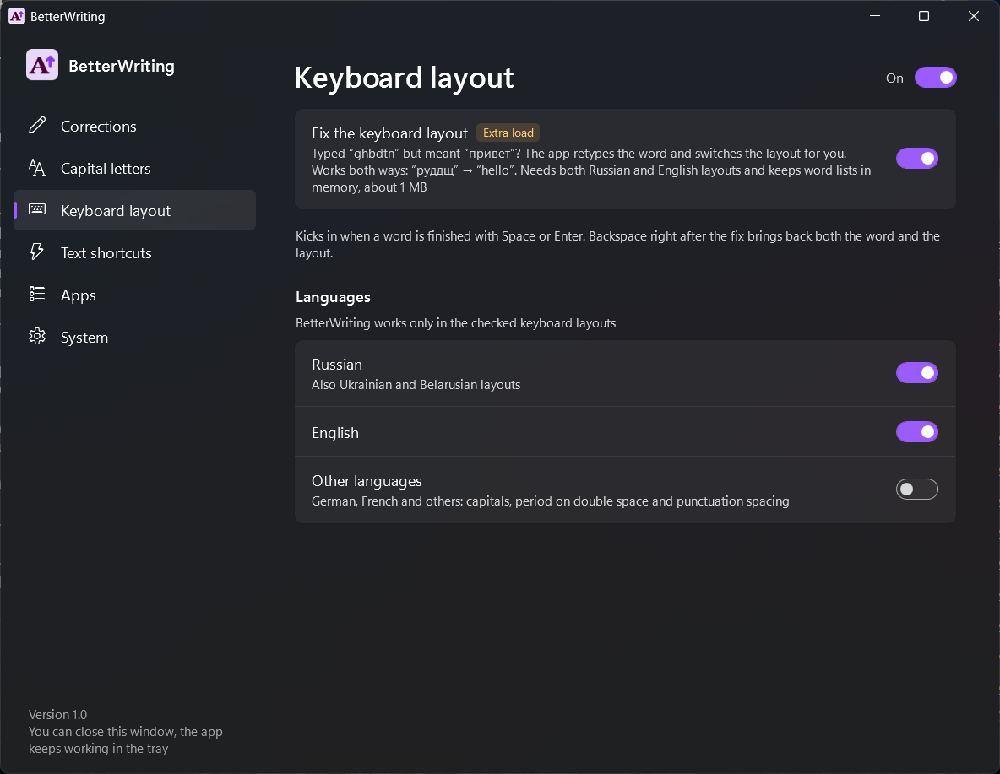
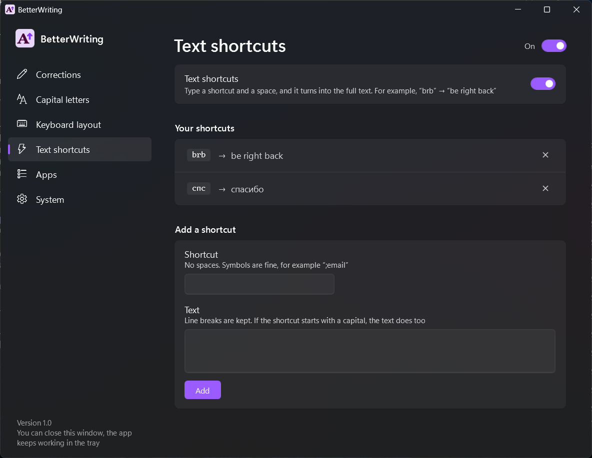
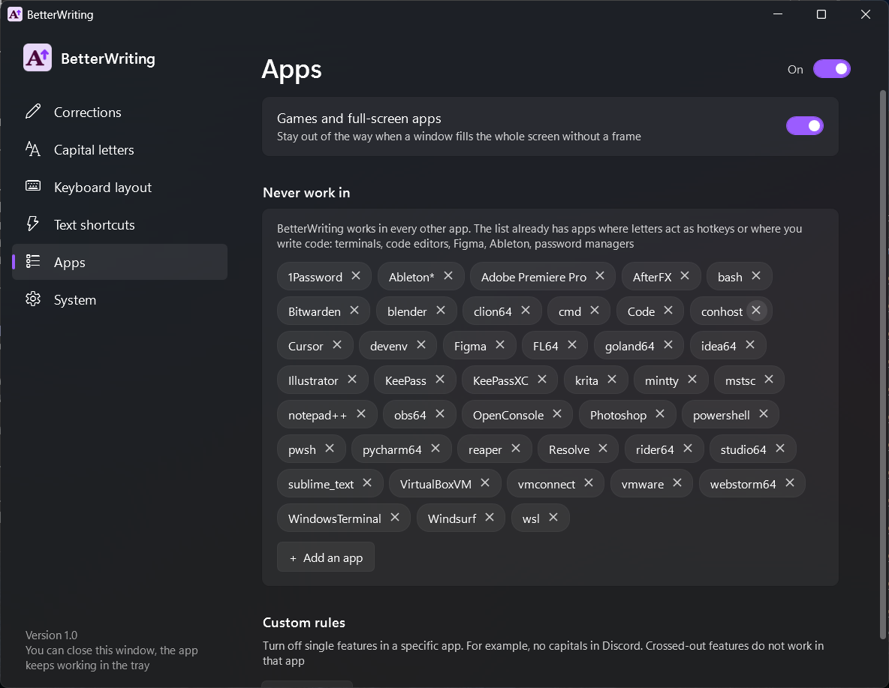
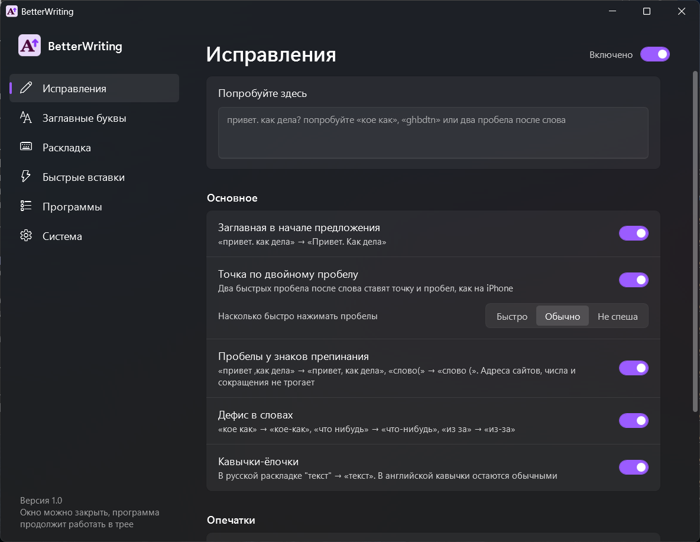

<p align="center">
  
</p>

<h1 align="center">BetterWriting</h1>

<p align="center">
  <b>iPhone-style auto-capitalization, double-space period and smart fixes in every Windows app.</b><br>
  A tiny tray app. No installer, no internet, no telemetry.
</p>

<p align="center">
  <a href="../../releases/latest"></a>
</p>

<p align="center">
  
  
  
  <a href="README.ru.md"></a>
</p>

<p align="center">
  
</p>

## Why

Your phone fixes the small stuff while you type: the capital at the start of a sentence, the period after two spaces.
Windows 11 has the same options, but **only for the touch keyboard**. BetterWriting brings them to a real keyboard,
in every app: browsers, messengers, Word, Notepad, Discord, Telegram and the rest.

## Features

| | What it does | Example |
|---|---|---|
| **Capitals** | Starts every sentence with a capital letter. Knows abbreviations, links and numbers | `hello. how are you` → `Hello. How are you` |
| **Double-space period** | Two quick spaces after a word insert a period and a space | `done␣␣next` → `done. Next` |
| **Punctuation spacing** | Removes the space before a comma, adds one after punctuation and before `(` | `hello ,world` → `hello, world` |
| **Accidental Caps Lock** | Fixes the word and turns Caps Lock off | `hELLO` → `Hello` |
| **Common typos** | A small built-in list of frequent mistakes | `teh`, `definately` → `the`, `definitely` |
| **“I” in English** | Capitalizes the pronoun | `i think i'm right` → `I think I'm right` |
| **Wrong keyboard layout** | Retypes a word typed in the wrong layout and switches the layout for you (Russian ⇄ English) | `ghbdtn` → `привет`, `руддщ` → `hello` |
| **Text shortcuts** | Your own abbreviations that expand into text, line breaks included | `brb` → `be right back` |
| **Per-app rules** | Turn off single features in a specific app, or leave an app alone completely | no capitals in Discord |
| **Russian extras** | Hyphens and «guillemets» for Russian text | `кое как` → `кое-как`, `"текст"` → `«текст»` |

**Every correction can be undone:** press <kbd>Backspace</kbd> right after it and you get exactly what you typed.

It is careful by design:

- Before capitalizing after a click, it reads the text in front of the cursor (the same way Windows Narrator does), so it never capitalizes in the middle of a sentence.
- It does nothing in password fields, games and full-screen apps, and in code editors, terminals and password managers by default.
- The layout fix only works when both Russian and English layouts are installed. Tested on the 20,000 most frequent words: under 0.05% false positives.

## Install

1. Download **`BetterWriting.exe`** from [Releases](../../releases/latest) and put it in any folder.
2. Run it. The settings window opens and the icon appears in the tray.
3. In **System**, turn on **Start with Windows**. Done. You can close the window, the app keeps working in the tray.

Settings are saved to `BetterWriting.ini` next to the exe, so the app is fully portable.
The interface is in English by default; switch to Russian in **System → Language**.

> [!NOTE]
> BetterWriting watches the keyboard to do its job, and the app is not code-signed. Windows SmartScreen may warn
> you on the first run (**More info → Run anyway**), and Microsoft Defender sometimes flags such apps with a
> machine-learning guess like `Trojan:Win32/Bearfoos.A!ml`. The app never writes down or sends what you type,
> and the full source is here: you can read it and [build it yourself](#build-from-source) in one command.

## Using it

- **Left-click** the tray icon to open the settings. Running `BetterWriting.exe` again does the same.
- **Right-click** for a quick menu: pause (the icon turns grey), “Don't work in this app”, exit.
- Use the **Try it here** box at the top of the settings to see the corrections live.

<p align="center">
  
  
</p>
<p align="center">
  
  
</p>

## Performance and privacy

- **Idle:** 0% CPU. It wakes up only on a key press or a click.
- **Memory:** about 9 MB in the background. The settings window runs as a separate process and frees its memory when closed.
- **No network access at all.** Nothing is logged or stored except your settings file.
- Two features do a bit of extra work and are marked **Extra load** in the settings: reading the text before the
  cursor after a click or a window switch, and the layout fix (word lists take about 1 MB of memory).

## Limitations

- Windows does not let regular apps touch windows that run **as administrator**, so BetterWriting does not work there.
- In Chromium-based apps (Chrome, Edge, Discord, Electron apps) reading the text before the cursor turns on their
  accessibility support. It is unnoticeable on normal pages.
- The layout fix knows the standard US QWERTY and Russian ЙЦУКЕН layouts.
- Built and tested on Windows 11. Windows 10 should work (without the Mica background) but is not tested.

## Build from source

Nothing to install: the C# compiler ships with Windows (.NET Framework 4.8).

```bat
build.cmd
```

`BetterWriting.exe` appears next to `build.cmd`. Run the logic tests (typing scenarios) with:

```bat
tests\run.cmd
```

<details>
<summary>Project structure</summary>

| Path | What it is |
|---|---|
| `src/Engine.cs` | All correction logic and undo. No Windows API, covered by tests |
| `src/Hooks.cs` | Global keyboard and mouse hooks, layout and Caps Lock handling, sending replacements, per-app rules |
| `src/ContextReader.cs` | Reads the text before the cursor through UI Automation on a background thread |
| `src/Dictionaries.cs` | Word lists for the layout fix, stored as 64-bit hashes |
| `src/Program.cs` | Tray icon, menu, autostart, single instance, talking to the settings window |
| `src/SettingsWindow.cs`, `src/Settings.xaml` | The settings window (WPF, Mica, light and dark theme) |
| `src/Config.cs` | Reading and writing `BetterWriting.ini` |
| `src/Loc.cs` | English and Russian interface strings |
| `src/dict/` | Compressed word lists |
| `tests/` | Logic tests |
| `tools/make-icons.ps1` | Builds the icons from `assets/logo.png` |
| `tools/make-dicts.ps1` | Builds the word lists from FrequencyWords |

</details>

## License

[MIT](LICENSE) © 2026 Rudy Eastwick.

Word lists are derived from [FrequencyWords](https://github.com/hermitdave/FrequencyWords) (CC BY-SA 4.0),
see [THIRD-PARTY-NOTICES.md](THIRD-PARTY-NOTICES.md).
