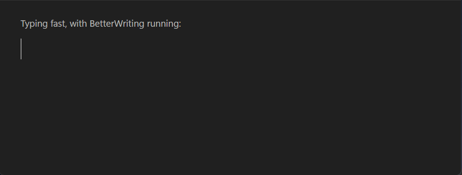
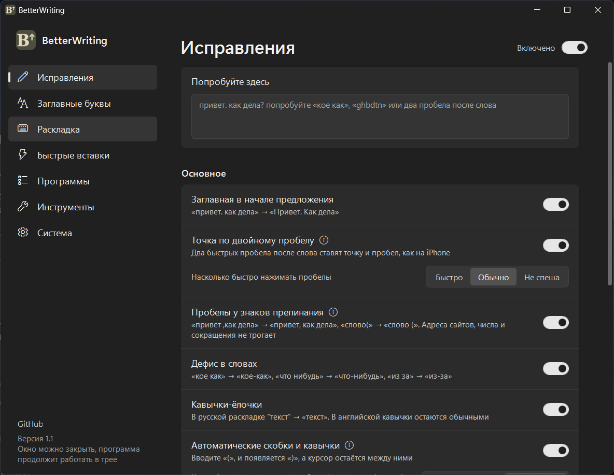

<p align="center">
  
</p>

<h1 align="center">BetterWriting</h1>

<p align="center">
  <b>Заглавные буквы, точка по двойному пробелу и умные исправления, как на iPhone, во всех программах Windows.</b><br>
  Маленькая программа в трее. Без установки, без интернета, без сбора данных.
</p>

<p align="center">
  <a href="../../releases/latest"></a>
</p>

<p align="center">
  
  
  
  <a href="README.md"></a>
</p>

<p align="center">
  
</p>

<p align="center">
  
</p>

## Зачем

Телефон сам поправляет мелочи, пока вы печатаете: заглавную в начале предложения, точку после двух пробелов.
В Windows 11 такие настройки тоже есть, но **только для сенсорной клавиатуры**. BetterWriting делает то же самое
для обычной клавиатуры во всех программах: в браузере, мессенджерах, Word, блокноте, Discord, Telegram.

## Возможности

| | Что делает | Пример |
|---|---|---|
| **Заглавные** | Начинает каждое предложение с заглавной. Понимает сокращения, ссылки и числа | `привет. как дела` → `Привет. Как дела` |
| **Точка по двойному пробелу** | Два быстрых пробела после слова ставят точку и пробел | `готово␣␣дальше` → `готово. Дальше` |
| **Пробелы у знаков** | Убирает пробел перед запятой, добавляет после знаков и перед `(` | `привет ,как` → `привет, как` |
| **Дефисы** | Ставит дефис там, где его забыли, в том числе в словах, написанных слитно. Не трогает «кое с кем» | `кое как`, `какието` → `кое-как`, `какие-то` |
| **Кавычки-ёлочки** | В русской раскладке, с вложенными „лапками“ | `"текст"` → `«текст»` |
| **Случайный Caps Lock** | Исправляет слово и выключает Caps Lock | `пРИВЕТ` → `Привет` |
| **Частые ошибки** | Встроенный словарь и ваши собственные исправления | `вообщем`, `извени` → `в общем`, `извини` |
| **Неправильная раскладка** | Перепечатывает слово и сама переключает раскладку | `ghbdtn` → `привет`, `руддщ` → `hello` |
| **Автоскобки** | По умолчанию выключены. Сама закрывает скобки и кавычки. Чтобы выйти за скобку, ненадолго удержите пробел или нажмите его дважды, на ваш выбор | `(привет` + удержать <kbd>Пробел</kbd> → `(привет)` |
| **Быстрые вставки** | Свои сокращения, которые разворачиваются в текст, с переносами строк. В текст можно подставить `{date}`, `{time}` и `{clipboard}` | `спс` → `спасибо` |
| **Раскладка для каждой программы** | По умолчанию выключена. Запоминает, на какой раскладке вы печатали в программе, и возвращает её | Telegram на русском, браузер на английском |
| **Индикатор раскладки** | При смене раскладки или Caps Lock на секунду показывает её у курсора мыши. Три размера | `РУС`, `ENG`, `CAPS ON` |
| **Поверх всех окон** | Закрепляет окно над остальными: кнопка по правому клику на заголовке окна или своя горячая клавиша | |
| **Вставка без форматирования** | Вставляет чистый текст по своей горячей клавише, без шрифтов и цветов | |
| **Не засыпать** | Не даёт компьютеру заснуть 1 час, 3 часа или пока не выключите. Из меню в трее, из настроек или по своей горячей клавише | |
| **Правила для программ** | Выключить отдельные функции в конкретной программе или не трогать её совсем | Discord без заглавных |
| **Горячая клавиша паузы** | Пауза и возобновление откуда угодно. Сочетание можно поменять или убрать | <kbd>Ctrl</kbd>+<kbd>Alt</kbd>+<kbd>B</kbd> |

**Любую автозамену можно отменить:** нажмите <kbd>Backspace</kbd> сразу после неё, и вернётся ровно то, что вы напечатали.

Программа осторожная:

- Прежде чем поставить заглавную после клика, она читает текст перед курсором (так же, как экранный диктор Windows), поэтому не ставит заглавную посреди фразы.
- Ничего не делает в полях паролей, играх и полноэкранных приложениях, а по умолчанию и в редакторах кода, терминалах и менеджерах паролей.
- Исправление раскладки работает, только если установлены и русская, и английская раскладки. Проверено на 20 000 самых частых слов: ложных срабатываний меньше 0,05%.

## Установка

1. Скачайте **`BetterWriting.exe`** из [Releases](../../releases/latest) и положите в любую папку.
2. Запустите. Откроется окно настроек, а в трее появится значок.
3. В разделе **System → Language** выберите **Русский**, а в **«Система»** включите **«Запускать вместе с Windows»**. Окно можно закрыть, программа продолжит работать в трее.

Настройки хранятся в `%APPDATA%\BetterWriting\BetterWriting.ini`, поэтому новая версия их сохраняет: скачали, запустили, и всё на месте. Прежде чем новая версия изменит файл, она сохранит рядом его копию, например `BetterWriting.ini.v1.bak`. Файл настроек, оставшийся рядом со старым exe, переедет туда сам.
Тема по умолчанию тёмная, переключается в **«Система → Тема»**.

> [!NOTE]
> Чтобы работать, программа следит за клавиатурой и при этом не подписана цифровой подписью. Поэтому при первом запуске
> SmartScreen может предупредить (**Подробнее → Выполнить в любом случае**), а Защитник Windows иногда помечает такие
> программы догадкой нейросети вроде `Trojan:Win32/Bearfoos.A!ml`. Программа никогда не записывает и не отправляет
> то, что вы печатаете, а весь код открыт: его можно прочитать и [собрать самому](#сборка) одной командой.

## Как пользоваться

- **Левый клик** по значку в трее открывает настройки. Повторный запуск `BetterWriting.exe` делает то же самое.
- **Правый клик** открывает меню: пауза (значок станет серым), «Не работать в этой программе», «Не засыпать», выход.
- <kbd>Ctrl</kbd>+<kbd>Alt</kbd>+<kbd>B</kbd> ставит на паузу и снимает с неё откуда угодно.
- В поле **«Попробуйте здесь»** вверху настроек исправления видно сразу, а при наведении на значок **ⓘ** рядом с функцией идёт короткая анимация.

## Скорость и приватность

- **В простое:** около 0% процессора. Программа просыпается на нажатие клавиши или клик и раз в 10 секунд на короткую проверку, не отключила ли Windows её перехват клавиатуры. Если отключила, программа подключается заново сама.
- **Память:** около 9 МБ в фоне. Окно настроек работает отдельным процессом и освобождает память после закрытия.
- **Никакого доступа в интернет.** Ничего не записывается и не хранится, кроме файла настроек.
- Две функции работают чуть больше остальных и помечены в настройках как **«Нагрузка»**: чтение текста перед
  курсором после клика или перехода в окно и исправление раскладки (словари занимают около 1 МБ памяти).

## Ограничения

- В окна, запущенные **от администратора**, Windows не пускает обычные программы, поэтому там BetterWriting не работает.
- В программах на Chromium (Chrome, Edge, Discord, приложения на Electron) чтение текста перед курсором включает в них
  поддержку специальных возможностей. На обычных страницах это незаметно.
- Исправление раскладки знает стандартные раскладки: английскую QWERTY и русскую ЙЦУКЕН.
- Сделано и проверено на Windows 11. На Windows 10 должно работать, но не проверялось.

## Сборка

Ничего устанавливать не нужно, компилятор C# встроен в Windows (.NET Framework 4.8):

```bat
build.cmd
```

`BetterWriting.exe` появится рядом с `build.cmd`. Тесты логики (сценарии набора текста):

```bat
tests\run.cmd
```

## Лицензия

[MIT](LICENSE) © 2026 Rudy Eastwick.

Словари сделаны на основе [FrequencyWords](https://github.com/hermitdave/FrequencyWords) (CC BY-SA 4.0),
подробнее в [THIRD-PARTY-NOTICES.md](THIRD-PARTY-NOTICES.md).
